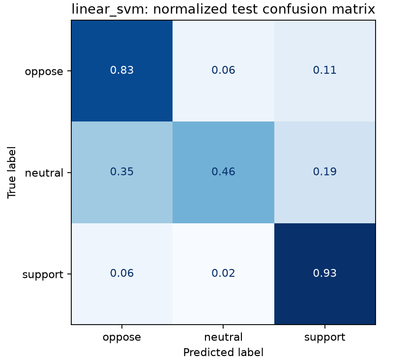

# Task A: Vote-level stance mining

This experiment predicts `oppose`, `neutral`, or `support` from cleaned RfA comment text. Leading
vote labels were masked before modeling (3,327 occurrences in 3,261 comments; none remained). The
chronological split keeps elections intact: 101,118 training, 33,117 validation, and 36,095 test
votes; 210 votes from fully undated elections were excluded. Macro-F1 is the primary metric.

## Test results

| Model | Macro-F1 | Accuracy | Macro-F1 on text unseen in training |
|---|---:|---:|---:|
| Majority class | 0.274 | 0.696 | 0.269 |
| TF-IDF + Logistic Regression | 0.724 | 0.846 | 0.722 |
| TF-IDF + Linear SVM | **0.740** | **0.872** | **0.739** |
| RoBERTa | — | — | — |

Linear SVM was the best classical model. Its class F1 scores were 0.793 for oppose, 0.492 for
neutral, and 0.935 for support, so neutral remains the main weakness. The nearly unchanged score on
comments not seen verbatim during training suggests exact text overlap has little effect on the
reported result. The majority baseline predicts support for every vote; its 0.696 accuracy reflects
class imbalance rather than useful classification.



*Rows are normalized by the true class.*

## Reproduce

Run the classical experiment from the repository root with Python 3.12:

```sh
python3.12 -m venv .venv
source .venv/bin/activate
python -m pip install -r requirements.txt
python -m votelens.stance
```

Results are written to `outputs/rfa_stance/`. To reproduce the pending RoBERTa experiment on a CUDA
GPU using the same split and evaluation:

```sh
python -m pip install -r requirements-transformer.txt
python -m votelens.stance_transformer \
  --model-name FacebookAI/roberta-base \
  --batch-size 8 \
  --gradient-accumulation 4 \
  --max-length 256 \
  --epochs 3
```
