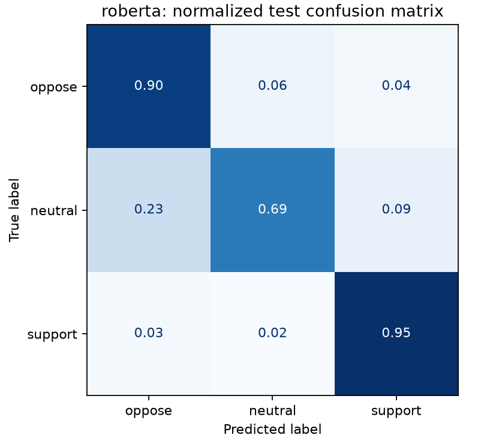

# Task A: Vote-level stance mining

This experiment predicts `oppose`, `neutral`, or `support` from cleaned RfA comment text. Before
modeling, 3,327 leading vote-label occurrences were masked in 3,261 comments; none remained after
the leakage check. Elections were kept intact in a chronological split: 101,118 training, 33,117
validation, and 36,095 test votes. Another 210 votes from fully undated elections were excluded.

## Test results

| Model | Macro-F1 | Accuracy | Macro-F1 on text unseen in training |
|---|---:|---:|---:|
| Majority class | 0.274 | 0.696 | 0.269 |
| TF-IDF + Logistic Regression | 0.724 | 0.846 | 0.722 |
| TF-IDF + Linear SVM | 0.740 | 0.872 | 0.739 |
| RoBERTa | **0.833** | **0.924** | **0.834** |

RoBERTa improved Macro-F1 by 0.093 and accuracy by 0.052 over Linear SVM, the strongest classical
model. Its score on comments not seen verbatim during training was effectively unchanged, so exact
text overlap does not explain the improvement. Accuracy alone is misleading for the majority
baseline: it predicts support for every vote and benefits from support making up 69.6% of the test
set.



*Rows are normalized by the true class.* RoBERTa recalled approximately 90% of oppose votes, 69% of
neutral votes, and 95% of support votes. Neutral remained the hardest class; about 23% of neutral
votes were classified as oppose.

## Reproduce

Run the classical models from the repository root with Python 3.12:

```sh
python3.12 -m venv .venv
source .venv/bin/activate
python -m pip install -r requirements.txt
python -m votelens.stance
```

Run RoBERTa on a Linux machine with an NVIDIA CUDA GPU:

```sh
python3.12 -m venv .venv
source .venv/bin/activate
python -m pip install -r requirements-transformer.txt
python -c "import torch; assert torch.cuda.is_available(), 'CUDA GPU not available'"
python -m votelens.stance_transformer \
  --model-name FacebookAI/roberta-base \
  --batch-size 8 \
  --gradient-accumulation 4 \
  --max-length 256 \
  --epochs 3
```

Classical outputs are written to `outputs/rfa_stance/`; RoBERTa outputs are written to
`outputs/rfa_stance/roberta/`. See [the experiment notes](../../docs/task_A_experiment.md) for the
split rationale and output inventory.
